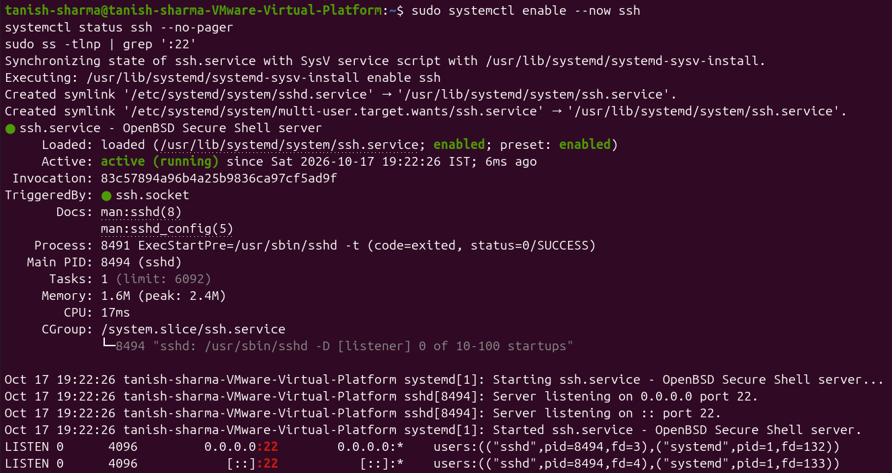
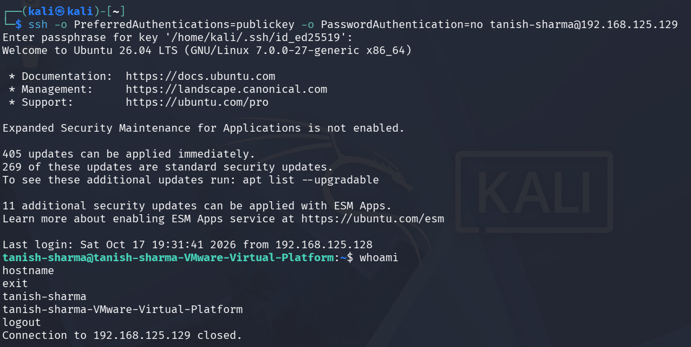

# Exp-6: Establish Secure Remote Login Using SSH

## Aim

To demonstrate secure remote server access using SSH with password-based and public-key authentication.

## Objectives

- Check the installed OpenSSH client on Kali Linux.
- Install and configure the OpenSSH server on Ubuntu.
- Establish a password-based SSH connection and verify the remote account and host.
- Generate an Ed25519 key pair and inspect its public-key fingerprint.
- Install the public key on the server and test key-based authentication without password fallback.
- Examine SSH host-key verification and changed-host warnings.
- Understand the importance of protecting private keys and verifying server identity.

## Requirements

- Kali Linux client and Ubuntu server
- OpenSSH client and server
- Network connectivity between the two systems
- Linux terminal

## Theory

SSH encrypts communication between a client and server, commonly over TCP port 22. OpenSSH provides the client and server tools used to establish and authenticate these connections.

Password authentication verifies a user's account password. Public-key authentication instead uses a key pair: the private key stays on the client, while the matching public key is stored in the server account's `~/.ssh/authorized_keys` file. The private key must never be shared.

The SSH client stores previously accepted server host keys in `~/.ssh/known_hosts`. A changed-host warning means the server is presenting a different key. This can happen after a legitimate rebuild, but can also indicate an impersonation attempt. Verify the new fingerprint through a trusted channel before accepting it; do not bypass the warning blindly.

## Procedure

The command guides in [Code/client_commands.sh](Code/client_commands.sh) and [Code/server_commands.sh](Code/server_commands.sh) contain the commands for each machine. Replace the example username and host values with your own, and run the commands section by section rather than executing the entire guide as one script.

### 1. Check the SSH client

On Kali Linux, check that OpenSSH is available:

```bash
ssh -V
```


### 2. Install and configure the SSH server

On Ubuntu, install OpenSSH Server if needed, start and enable the service, and verify that it is listening on TCP port 22. Record the server username, hostname, IP address, and Ed25519 host-key fingerprint. The server command guide includes these checks.



### 3. Connect with a password and verify the remote shell

From Kali, connect using `ssh <ubuntu-user>@<ubuntu-ip>`. Verify the host-key fingerprint before accepting it on the first connection. Once connected, run `whoami`, `hostname`, and `pwd`, then use `exit` to return to Kali.


### 4. Generate an Ed25519 key pair

On Kali, generate a key pair, inspect the files, and display the public-key fingerprint:

```bash
ssh-keygen -t ed25519 -C "student@lab"
ls -l ~/.ssh/id_ed25519*
ssh-keygen -lf ~/.ssh/id_ed25519.pub
```

Keep the private key (`~/.ssh/id_ed25519`) on the client and protect it with a passphrase.


### 5. Install the public key

Set restrictive permissions and copy only the public key to the Ubuntu account:

```bash
chmod 700 ~/.ssh
chmod 600 ~/.ssh/id_ed25519
ssh-copy-id -i ~/.ssh/id_ed25519.pub <ubuntu-user>@<ubuntu-ip>
```


### 6. Test public-key authentication

Disable password fallback for this test so the connection succeeds only if public-key authentication is configured:

```bash
ssh -o PreferredAuthentications=publickey -o PasswordAuthentication=no <ubuntu-user>@<ubuntu-ip>
```

After connecting, verify the remote user and hostname, then exit the session.



Optionally, start the SSH agent, add the private key, and connect again:

```bash
eval "$(ssh-agent -s)"
ssh-add ~/.ssh/id_ed25519
ssh <ubuntu-user>@<ubuntu-ip>
```


### 7. Observe changed-host detection

In a controlled lab, observe how SSH warns when the server presents a host key different from the one recorded in `known_hosts`. A changed key is not proof of an attack, but the fingerprint must be independently verified before the new key is trusted.

## Result

The OpenSSH client and server were examined, a password-based remote login was established, and an Ed25519 key pair was used to configure public-key authentication. The host-key verification behavior was also studied.

## Conclusion

The experiment demonstrated secure remote access using SSH password and public-key authentication. It highlighted private-key protection and server host-key verification as essential parts of secure remote administration.